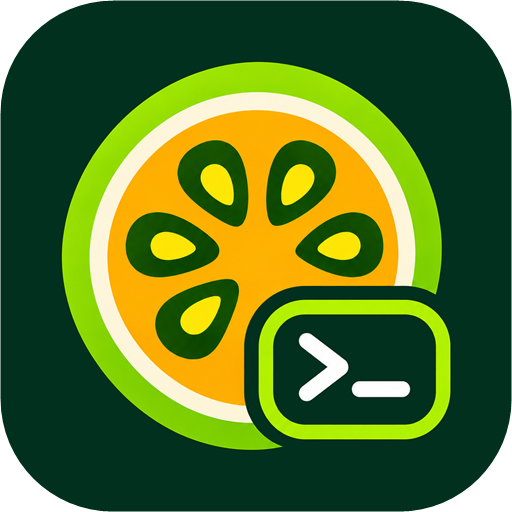

<p align="center">
  
</p>

<h1 align="center">LuloSSH</h1>

<p align="center"><a href="README.md">English</a> · <strong>Español</strong></p>

Cliente SSH para móviles y tablets Android (iOS en desarrollo), pensado para
trabajar en consola desde una pantalla táctil: claves guardadas de forma
segura, sesiones persistentes con tmux, hasta cuatro terminales en la tablet,
atajos de teclado físico y una barra de teclas propia con una capa para CLIs
de IA (Claude Code, Devin y similares).

> Estado: alfa (0.2.0). Se usa a diario en móviles y tablets Android; la
> versión de iOS compila y funciona en el simulador, pero aún no está
> publicada. Descarga el APK firmado desde
> [Releases](https://github.com/Citters-Technologies/lulossh/releases/latest).

## Por qué existe LuloSSH

Durante años, JuiceSSH fue nuestra herramienta diaria para administrar
servidores desde el móvil. Nos dio mucha pena que el proyecto se
descontinuara: lo echamos de menos, sobre todo su teclado de consola, que
hacía cómodo trabajar en una terminal desde una pantalla táctil.

LuloSSH nace para recuperar esa experiencia, esta vez como software libre
para que no pueda desaparecer, y adaptada a cómo trabajamos hoy: cada vez más
con asistentes de IA en la terminal.

> LuloSSH es un proyecto independiente. No está afiliado, asociado ni
> respaldado por JuiceSSH ni por Sonelli Ltd. No contiene código de JuiceSSH.

## Características

**Terminal y SSH**
- SSH con contraseña o clave; generación de claves ed25519 e importación OpenSSH / PEM / PuTTY (.ppk).
- Terminal completa (xterm.js) dibujada con la GPU (WebGL), con scroll táctil (también dentro de Devin, Claude Code, vim…), tiradores de selección, copiar/pegar y temas de color (Solarized, Dracula, Nord, Gruvbox, negro sobre blanco…).
- Las sesiones siguen vivas en segundo plano (servicio en primer plano) y se detectan las conexiones muertas tras un cambio de red.
- **Sesiones persistentes con tmux** (por host): al reconectar vuelves al mismo terminal con los programas aún en marcha, y la misma sesión se puede compartir entre móvil, tablet y ordenador.
- Barra de teclas editable con una capa para CLIs de IA (Esc Esc, Shift+Tab, Ctrl+C/D/R, `/`, `@`, `#`…).

**Tablets y teclados**
- Lista de hosts y terminal en paralelo; **hasta cuatro terminales en pantalla** (una, dos en columnas o filas, cuadrícula 2×2) con pestañas de sesiones y panel lateral plegable. Funciona en el modo escritorio / ventanas de Android.
- Teclado físico: acentos con tecla muerta, F1–F12, modificadores con flechas, modo de cursor de aplicación y atajos:

  | Atajo | Acción |
  | --- | --- |
  | Ctrl+Tab / Ctrl+Shift+Tab | Panel (o sesión) siguiente / anterior |
  | Ctrl+Shift+1…4 | Ir al panel 1–4 |
  | Ctrl+Shift+L | Mostrar / ocultar la lista de hosts |
  | Ctrl+Shift+C / Ctrl+Shift+V | Copiar la selección / pegar |
  | Ctrl + / Ctrl − | Letra más grande / más pequeña |

**Seguridad y datos**
- Claves y contraseñas en un almacén cifrado con Android Keystore (Keychain en iOS), con biometría o el PIN del dispositivo.
- Importación desde Xshell (incluidas las contraseñas guardadas, con la contraseña maestra) y JuiceSSH.
- Copia de seguridad cifrada (scrypt + AES-256-GCM).
- Apariencia clara, oscura o la del sistema.

**Previsto:** sincronización cifrada de extremo a extremo entre dispositivos, SFTP, redirección de puertos, Mosh y publicación en iOS.

## Arquitectura

| Capa | Tecnología |
| --- | --- |
| Interfaz y lógica | React Native 0.88 + TypeScript, Expo SDK 58 (bare workflow) |
| SSH (Android) | Módulo nativo en Kotlin + sshj / BouncyCastle |
| SSH (iOS) | Módulo nativo en Swift + Citadel (SwiftNIO SSH), en desarrollo |
| Terminal | xterm.js 6 en un WebView, dibujo WebGL |
| Claves | Android Keystore / iOS Keychain |

El contrato del módulo nativo está en `src/native/SshModule.ts` y cada
plataforma lo implementa por separado (`android/app/src/main/java/com/lulossh/ssh`,
`ios/LuloSSH`). La página del terminal la genera `scripts/build-terminal.js`
(xterm.js, addons, `src/terminal/bridge.js` y la fuente incrustada).

## Desarrollo

Requisitos: Node 22+, JDK 17 y el SDK de Android; para iOS, un Mac con Xcode
y CocoaPods.

```sh
npm install          # genera también la página del terminal
npm test
npx expo start       # servidor de desarrollo
npm run android      # compila y lanza en un dispositivo/emulador
npm run ios          # (macOS) compila y lanza en el simulador
```

APK de publicación: `cd android && ./gradlew assembleRelease`. La clave de
firma se lee de las propiedades `LULOSSH_UPLOAD_*` de tu configuración de
Gradle de usuario y nunca se guarda en el repositorio. GitHub Actions compila
la app de iOS en cada push (`.github/workflows/ios.yml`).

## Licencia

Copyright (C) 2026 Citters Technologies SLU

LuloSSH se distribuye bajo la **GNU Affero General Public License v3.0**
(ver [LICENSE](LICENSE)). Puedes usarlo, modificarlo y redistribuirlo, pero
cualquier versión modificada, incluida la que se ofrezca como servicio en red,
debe publicarse bajo la misma licencia, conservando los avisos de copyright.

### Licencia comercial

Si quieres integrar LuloSSH en un producto propietario o cerrado sin las
obligaciones de la AGPL, puedes adquirir una licencia comercial.
Contacto: hola@citters.com

### Contribuciones

Para poder ofrecer la licencia comercial, las contribuciones externas
requieren aceptar un acuerdo de licencia de contribuidor (CLA) que permita
a los titulares del proyecto relicenciar el código aportado.
Ver [CONTRIBUTING.es.md](CONTRIBUTING.es.md).
