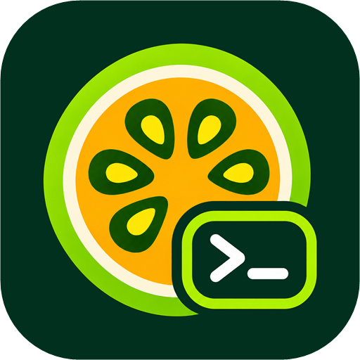

<p align="center">
  
</p>

<h1 align="center">LuloSSH</h1>

<p align="center"><strong>English</strong> · <a href="README.es.md">Español</a></p>

An SSH client for Android phones and tablets (iOS in progress), built for
real terminal work on a touchscreen: securely stored keys, persistent tmux
sessions, up to four terminals on a tablet, hardware keyboard shortcuts and a
custom key bar with a dedicated layer for AI coding CLIs (Claude Code, Devin
and similar).

> Status: alpha (0.2.0). Used daily on Android phones and tablets; the iOS
> version builds and runs in the simulator but is not released yet. Download
> the signed APK from
> [Releases](https://github.com/Citters-Technologies/lulossh/releases/latest).

## Why LuloSSH exists

For years, JuiceSSH was our everyday tool for managing servers from a phone.
We were sad to see the project discontinued: we miss it, especially its
terminal keyboard, which made working in a shell on a touchscreen genuinely
comfortable.

LuloSSH is our attempt to bring that experience back, this time as free
software so it can't disappear, and adapted to how we work today: more and
more alongside AI assistants in the terminal.

> LuloSSH is an independent project. It is not affiliated with, associated
> with, or endorsed by JuiceSSH or Sonelli Ltd. It contains no JuiceSSH code.

## Features

**Terminal and SSH**
- SSH with password or key authentication; ed25519 key generation, OpenSSH / PEM / PuTTY (.ppk) import.
- Full terminal emulation (xterm.js) drawn on the GPU (WebGL), with touch scrolling (also inside Devin, Claude Code, vim…), selection handles, copy/paste and colour themes (Solarized, Dracula, Nord, Gruvbox, black-on-white…).
- Sessions keep running in the background (foreground service); dead connections are detected after network changes.
- **Persistent sessions with tmux** (per host): reconnecting brings you back to the same terminal with programs still running, and the same session can be shared between phone, tablet and desktop.
- Editable key bar with a dedicated layer for AI coding CLIs (Esc Esc, Shift+Tab, Ctrl+C/D/R, `/`, `@`, `#`…).

**Tablets and keyboards**
- Host list and terminal side by side; **up to four terminals on screen** (one, two in columns or rows, 2×2 grid) with session tabs and a collapsible side pane. Works in Android desktop / windowed mode.
- Hardware keyboards: dead-key accents, F1–F12, modifier + arrow sequences, application cursor mode, and shortcuts:

  | Shortcut | Action |
  | --- | --- |
  | Ctrl+Tab / Ctrl+Shift+Tab | Next / previous pane (or session) |
  | Ctrl+Shift+1…4 | Go to pane 1–4 |
  | Ctrl+Shift+L | Show / hide the host list |
  | Ctrl+Shift+C / Ctrl+Shift+V | Copy selection / paste |
  | Ctrl + / Ctrl − | Larger / smaller font |

**Security and data**
- Keys and passwords in a vault encrypted with the Android Keystore (Keychain on iOS), unlocked with biometrics or the device PIN.
- Import from Xshell (including saved passwords with the master password) and JuiceSSH.
- Encrypted backup / restore (scrypt + AES-256-GCM).
- Light, dark or system appearance.

**Planned:** end-to-end encrypted sync across devices, SFTP, port forwarding, Mosh, iOS release.

## Architecture

| Layer | Technology |
| --- | --- |
| UI and logic | React Native 0.88 + TypeScript, Expo SDK 58 (bare workflow) |
| SSH (Android) | Native module in Kotlin + sshj / BouncyCastle |
| SSH (iOS) | Native module in Swift + Citadel (SwiftNIO SSH), in progress |
| Terminal | xterm.js 6 in a WebView, WebGL renderer |
| Keys | Android Keystore / iOS Keychain |

The native module contract lives in `src/native/SshModule.ts`; each platform
implements it separately (`android/app/src/main/java/com/lulossh/ssh`,
`ios/LuloSSH`). The terminal page is generated by `scripts/build-terminal.js`
(xterm.js, addons, `src/terminal/bridge.js` and the embedded font).

## Development

Requirements: Node 22+, JDK 17 and the Android SDK; for iOS, a Mac with
Xcode and CocoaPods.

```sh
npm install          # also generates the terminal page
npm test
npx expo start       # development server
npm run android      # build and run on a device/emulator
npm run ios          # (macOS) build and run on the simulator
```

Release APK: `cd android && ./gradlew assembleRelease`. The signing key is
read from `LULOSSH_UPLOAD_*` properties in your Gradle user properties and is
never stored in the repository. GitHub Actions builds the iOS app on every
push (`.github/workflows/ios.yml`).

## License

Copyright (C) 2026 Citters Technologies SLU

LuloSSH is distributed under the **GNU Affero General Public License v3.0**
(see [LICENSE](LICENSE)). You may use, modify and redistribute it, but any
modified version, including one offered as a network service, must be
released under the same license, keeping the copyright notices.

### Commercial license

If you want to embed LuloSSH in a proprietary or closed-source product
without the AGPL obligations, a commercial license is available.
Contact: hola@citters.com

### Contributing

To be able to offer the commercial license, external contributions require
accepting a Contributor License Agreement (CLA) that allows the project
owners to relicense contributed code. See [CONTRIBUTING.md](CONTRIBUTING.md).
